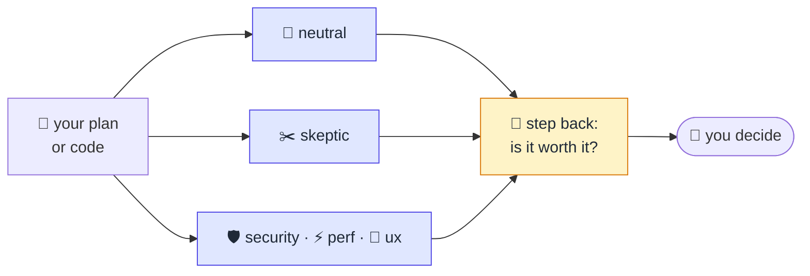

# devs

<p align="center">
  
</p>

A small development process with roles, for AI coding agents. You brainstorm the
idea, write a plan, review it with fresh agents, implement it, and review the
code the same way. A "step back" agent asks if the work is worth it. You see
only the judgment calls.

## Flow


Start each stage with its command (`/devs:brainstorm`, `/devs:plan`,
`/devs:review`, `/devs:implement`) or in plain words, for example "review this
with security and skeptic".

## Skills

| Skill | What it does |
|---|---|
| `brainstorm` | A two-way talk about the idea: the model brings options, opinions, and prior art, and grills you one question at a time until every decision is settled. Uses Matt Pocock's `grilling` method (`skills/brainstorm/grilling.md`). |
| `plan` | Takes any input, grills only the open decisions, writes `plan.md`. |
| `review` | Fresh reviewers → sort findings → apply clear fixes → step back verdict → your decisions. Works on the plan and on the code. |
| `implement` | Builds from `plan.md`, runs the project checks until they pass, commits. |

## Review



- **Reviewers** run as fresh subagents with no chat history. `neutral` and
  `skeptic` always run. `security`, `performance`, and `ux` run when the change
  touches that area or when you ask.
- **Persona files** are in `skills/review/personas/`. Each has an "On a plan"
  and an "On code" section, plus "Tuning notes" for your own rules.
- **Sorting.** The main session opens the cited code and labels each finding:
  - FIX: right and clear, so it is applied.
  - CONTEST: wrong, with evidence you can check.
  - ESCALATE: needs your judgment, so you get a question.
  - DECLINE: right but too small to matter.
- **Step back.** One more fresh agent reads the plan and the findings and says
  GO, CHANGE COURSE, or STOP.
- **You see** the verdict, one count line, and the escalated questions one at
  a time. The details are in `.work/<feature>/plan-review.md` or
  `code-review.md`.

## Files per feature

```
.work/<feature>/
  plan.md          # the plan, the source of truth
  plan-review.md   # plan review rounds
  base-commit      # commit before implement; the code review diffs from here
  code-review.md   # code review rounds
```

Commit `.work/` or add it to `.gitignore`. Each project decides.

## Install (Claude Code)

```
/plugin marketplace add urza/devs
/plugin install devs@devs
```

The skeptic uses [Ponytail](https://github.com/DietrichGebert/ponytail).
Install it too:

```
/plugin marketplace add DietrichGebert/ponytail
/plugin install ponytail@ponytail
```

Other harnesses: the skills are plain `SKILL.md` files with no Claude Code tool
names. Copy `skills/` into the harness's skills folder. The `review` skill
needs a harness that can start fresh subagents.

## Development

`urza/devs` is the stable version that you install. Work happens in the fork
`d3mnjx/devs` and reaches `urza/devs` through pull requests.

## Credits

- `skills/brainstorm/grilling.md` is copied unchanged from
  [mattpocock/skills](https://github.com/mattpocock/skills) at `4ae2317`, MIT
  license (see `skills/brainstorm/grilling-LICENSE`).
- The skeptic uses [Ponytail](https://github.com/DietrichGebert/ponytail).
- The fresh reviewers and the finding labels come from Google's
  [Elephant-Goldfish Model](https://github.com/google/elephant-goldfish-model).
