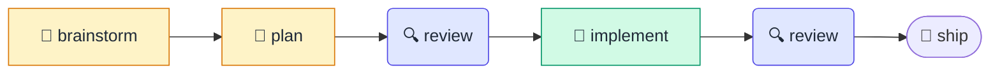
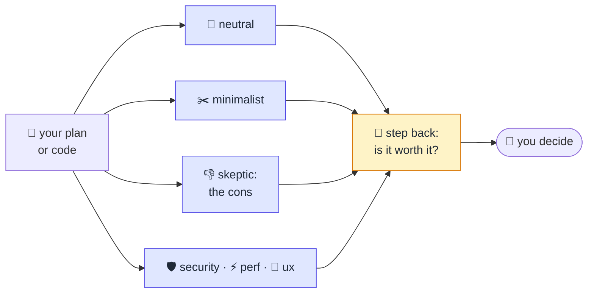

# devs

<p align="center">
  
</p>

A small development process with roles, for AI coding agents. You brainstorm the
idea, write a plan, review it with fresh agents, implement it, and review the
code the same way. A "step back" agent asks if the work is worth it. You see
only the judgment calls.

## Flow



Run `/devs:start` with an issue, a file, or a sentence, or with nothing and
it asks what to work on. Each stage then loads the next one by itself. It
stops only for your answers, a CHANGE COURSE or STOP verdict, or a failed
build. It never merges or pushes.

For a small change (a list of nits, a bug with a known cause), `start`
offers the small path: plan, implement, and one neutral reviewer on the
code, with no plan review and no step back. It takes that path only when
you say yes.

You can also start any stage alone with its command (`/devs:brainstorm`,
`/devs:plan`, `/devs:review`, `/devs:implement`) or in plain words, for
example "review this with security and minimalist". Say "only the review" to
stop after that stage.

## Skills

| Skill | What it does |
|---|---|
| `start` | Takes the input (issue, file, text) or asks for it, picks the first stage, and runs the flow to the end. Continues an existing `.work/<feature>/` from its next stage. |
| `brainstorm` | A two-way talk about the idea: the model brings options, opinions, and prior art, and grills you one question at a time until every decision is settled. Uses Matt Pocock's `grilling` method (`skills/brainstorm/grilling.md`). |
| `plan` | Takes any input, grills only the open decisions, writes `plan.md`. |
| `review` | Fresh reviewers → sort findings → apply clear fixes → step back verdict → your decisions. Works on the plan and on the code. |
| `implement` | Builds from `plan.md`, runs the project checks until they pass, commits. |

## Review



| Persona | What it does |
|---|---|
| 🧐 `neutral` | A careful senior developer who sees the work for the first time. Checks that it is clear, complete, and does what it says. |
| ✂️ `minimalist` | The laziest senior developer in the room. "The best code is the code never written." Looks for what should not exist and what can be smaller. |
| 👎 `skeptic` | Reads only the plan and gives the cons. It has no checklist. |
| 🛡️ `security` | Reports only problems with a real path: who the attacker is, what they control, and what they get. |
| ⚡ `performance` | Finds the real load of the project, today and after months of use. Judges only against that. |
| 🎨 `ux` | Speaks for the person who uses the result. Taste is not a finding. |
| 🔭 `step back` | Was not in the room. Asks if this is the right thing, if it is worth it, and if a cheaper way exists. |

All except the skeptic can report that they found nothing. They never invent
a finding to have something to report.

- **Reviewers** run as fresh subagents with no chat history, on the same
  model as your session unless you name another. `neutral` and
  `minimalist` always run. `security`, `performance`, and `ux` run when the
  change touches that area or when you ask.
- **Skeptic.** One more fresh agent gets a single job: read the plan and
  give the cons, the reasons why this is bad. It has no checklist and no
  protected decisions. It runs on every plan, and on code when you ask. The
  main session does not filter its list: you see every con with a one-line
  answer, and you pick what changes.
- **Nobody is protected.** `plan.md` tags each decision `(user)` or
  `(agent)`. Before the review, `plan` lists the `(agent)` decisions for you
  in plain words. Reviewers question both kinds. A finding against one of
  your own decisions always comes back to you as a question.
- **Persona files** are in `skills/review/personas/`. Each has an "On a plan"
  and an "On code" section, plus "Tuning notes" for your own rules. The lists
  in a file are examples. A reviewer reports anything that fits its purpose.
- **Sorting.** The main session opens the cited code and labels each finding:
  - FIX: right and clear, so it is applied. A FIX only corrects or removes.
    A fix that adds a mechanism, an option, or a dependency comes to you as
    a question.
  - CONTEST: wrong, with evidence you can check.
  - ESCALATE: needs your judgment, so you get a question.
  - DECLINE: right but too small to matter.
- **Step back.** One more fresh agent reads the plan and the findings and says
  GO, CHANGE COURSE, or STOP. It can add remarks: parts it would drop,
  change, or check first, also on a GO. You see each remark as written and
  you answer it.
- **You see** the verdict, one count line, the skeptic's cons and the step
  back remarks, and the escalated questions one at a time. The details are
  in `.work/<feature>/plan-review.md` or `code-review.md`.
- **Status.** A review round ends with a `Status: done` line after your last
  answer. A round without it is not finished, and `start` returns to it.

## Coding principles

`skills/principles.md` holds your coding principles: simplicity,
maintainability, understandability, elegance, and comments that explain why.
`plan` and `implement` carry a copy inline, and `review` pastes it into the
neutral and minimalist reviewers' briefs. Security,
performance, ux, skeptic, and step back do not, so they stay in their own lanes. A
project's own AGENTS.md or CLAUDE.md wins where it differs.

## Files per feature

```
.work/<feature>/
  plan.md          # the plan, the source of truth
  plan-review.md   # plan review rounds
  base-commit      # commit before implement; the code review diffs from here
  code-review.md   # code review rounds
```

Commit `.work/` or add it to `.gitignore`. Each project decides.

## Install (Claude Code)

```
/plugin marketplace add urza/devs
/plugin install devs@urza
```

Other harnesses: the skills are plain `SKILL.md` files with no Claude Code tool
names. Copy `skills/` into the harness's skills folder. The `review` skill
needs a harness that can start fresh subagents.

## Development

`urza/devs` is the stable version that you install. Work happens in the fork
`d3mnjx/devs` and reaches `urza/devs` through pull requests.

## Credits

- `skills/brainstorm/grilling.md` is copied unchanged from
  [mattpocock/skills](https://github.com/mattpocock/skills) at `4ae2317`, MIT
  license (see `skills/brainstorm/grilling-LICENSE`).
- `skills/review/personas/minimalist.md` adapts the review rules of
  [Ponytail](https://github.com/DietrichGebert/ponytail) by Dietrich Gebert,
  MIT license (see `skills/review/personas/minimalist-LICENSE`).
- The fresh reviewers and the finding labels come from Google's
  [Elephant-Goldfish Model](https://github.com/google/elephant-goldfish-model).
